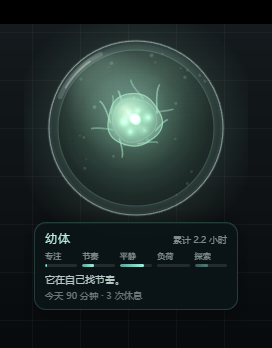
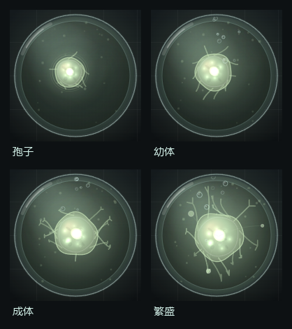
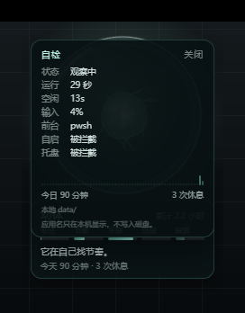

# 行为生态缸 / Behavior Eco Jar

一个常驻桌面的极简培养皿。里面养着一只抽象生物，它的形态、发光、游动方式，
以及水体的清澈度、颜色和气泡，都由你真实的工作节奏缓慢驱动。

它不是游戏：没有任务、没有货币、没有点击收益、没有成就弹窗，也不绑定任何 IP。
你不需要主动操作，正常工作就是在养它。



## 它怎么读你

每秒钟采样一次，只取三样东西：

| 信号 | 来源 | 用途 |
|---|---|---|
| 系统空闲时长 | `GetLastInputInfo` | 判断是否在场；离开 ≥ 3 分钟算一次真正的休息 |
| 这一秒有没有新输入 | 同上（空闲时长在变短） | 输入密度：把“在敲”和“在想”分开 |
| 前台进程名 | `GetForegroundWindow` + `QueryFullProcessImageNameW` | 统计切换次数与出现过的应用数量 |

每分钟结算成一个桶（活跃秒数、切换次数、有输入的秒数），滚动 45 分钟窗口算出五个维度：

| 维度 | 含义 | 直觉 |
|---|---|---|
| 专注 focus | 连续投入 | （在场 × 输入密度）× 低切换率 × 连续时长 |
| 节奏 rhythm | 工作/休息是否有规律 | 休息间隔的变异系数取反 |
| 平静 calm | 是否碎切、急躁 | 切换频率与“碎切分钟”占比取反 |
| 负荷 load | 是否过劳 | 连续活跃时长、迟迟不休息 |
| 探索 variety | 线索是否多样 | 45 分钟内出现过的应用数 + 切换频率；只有一个窗口时标记为“不可测”，给中性值 |

## 它怎么变

| 输入 | 生物 | 环境 |
|---|---|---|
| 专注高 | 通体发光增强、游动平稳 | 顶部光束变亮 |
| 节奏稳 | 触须变多、摆动有节律 | 水面涟漪更规律 |
| 平静高 | 膜更通透、体色偏冷青 | 水体清澈 |
| 负荷高 | 体表出现暗斑、动作迟滞 | 水体浑浊、发黄 |
| 探索高 | 色相从青绿偏向琥珀 | 悬浮微粒变多 |
| 主动休息 | 舒展、短暂加速 | 冒气泡 |
| 长时间离开 | 发光减弱、动作变慢 | 水色发灰 |

所有变化都带惯性（指数缓动，时间常数 2.5–10 分钟），不会因为一分钟的波动就突变。
关掉程序后会按小时衰减，但累计的工作时长和成长阶段不会倒退。

**成长阶段**（按累计活跃分钟）：孢子 0 → 幼体 45 → 成体 180 → 繁盛 480。

形态不是四张图切换，而是按“成熟度 = 阶段 + 阶段内进度”连续过渡：



- **孢子**：小、钝，外面裹着一层半透明的壳，只有几根短突起，光很弱；
- **幼体**：壳褪掉，膜变通透，触须开始摆动，能看到一个细胞核；
- **成体**：体型明显变大，触须末端分叉，体内出现液泡和第二细胞核；
- **繁盛**：外围长出 3–5 个共生小体，用细丝连回主体，水体里的悬浮微粒也更多。

## 交互

- **拖动**：按住培养皿拖到任何位置，位置会记住；超出屏幕会自动夹回可见范围。
- **悬停**：显示状态卡（阶段、累计时长、五维条形、一句话解读、今天累计与休息次数）。
- **右键**：暂停观察 / 自检面板 / 大小 / 不透明度 / 收进小圆点 / 重置 / 开机自启 / 关于 / 退出。
- **大小**：迷你（179×240）/ 紧凑（224×300）/ 标准（280×375），右键循环切换，记在存档里。
- **不透明度**：100% / 90% / 80% / 70%，右键循环切换，整个缸连同状态卡一起变淡。
- **收进小圆点**：收成 40×40 的边缘圆点，只留一颗发光珠子；左键或右键点它展开。
- **点击**：生物会收缩一下作为回应。
- **快捷键**：`Ctrl+Alt+J` 随时隐藏/显示培养皿（这台机器上托盘被安全软件挡住，这是主要入口）。
- **托盘**：左键显示/隐藏；右键菜单可暂停、开关开机自启、打开自检、退出。
  图标是亮青色圆环，Windows 11 默认把新图标收进折叠区（时钟左边的 `^`），
  拖到任务栏上可以常驻显示。**当前这台机器装不上，见“已知限制”。**
- 培养皿之外的区域完全点击穿透，不会挡住桌面。




自检面板是本机排障用的：当前空闲秒数、前台进程、最近 60 分钟的活跃桶、
今日累计与休息次数。前台进程名只在这里显示，不落盘。

## 运行

前置：Windows 10/11、WebView2 运行时（系统自带）、Rust（MSVC 目标）。

```powershell
# 正常模式：开始观察你的工作节奏
pwsh -File scripts/cargo.ps1 run

# 演示模式：把 1 秒压成 1 分钟，一分钟就能看完一轮
# “专注—休息—碎切—过劳”的完整循环
pwsh -File scripts/cargo.ps1 run -- --demo

# 测试
pwsh -File scripts/cargo.ps1 test
```

`scripts/cargo.ps1` 会自动加载本机 Visual Studio 的 `vcvars64.bat`，
并把 Rust 工具链指向项目内的 `.tools/`，不污染全局环境。

debug 构建会带一个控制台窗口（方便看日志）；release 构建用
`pwsh -File scripts/cargo.ps1 build --release`，产物在 `target/release/ecojar.exe`，
不带控制台，可以直接双击。

**开机自启**默认开启：首次运行会往 `HKCU\Software\Microsoft\Windows\CurrentVersion\Run`
写一条 `BehaviorEcoJar`，命令行带 `--autostart`。托盘菜单里可以随时关掉。
如果被终端安全软件拦截，自检面板会显示“被拦截”，可以手动执行：

```powershell
# 把路径换成你的实际位置
reg add "HKCU\Software\Microsoft\Windows\CurrentVersion\Run" /v BehaviorEcoJar /t REG_SZ /d "D:\Apps\BehaviorEcoJar\ecojar.exe --autostart" /f
```

同一时间只允许一个实例：第二个进程会直接退出并写日志。

## 安装与分发

```powershell
# 打 NSIS 安装包（需要 .tools/tauri-cli/cargo-tauri.exe）
pwsh -File scripts/bundle.ps1
```

产物：

```
dist/BehaviorEcoJar_0.1.0_x64-setup.exe   安装包（NSIS，约 2MB）
dist/BehaviorEcoJar_0.1.0_portable.zip    便携版（解压即用）
```

安装版默认按用户装到 `%LOCALAPPDATA%\BehaviorEcoJar`，卸载时保留 `data/`。
**在装了企业终端安全软件的机器上，别用默认安装位置**：这类软件常会拦截未签名程序写 AppData，
装完启动会因为建不出 WebView2 数据目录而失败。两个可行办法：

1. 用便携版，放在 `D:\` 这类有写权限的目录；
2. 用安装包但指定目录：`BehaviorEcoJar_0.1.0_x64-setup.exe /S /D=D:\Apps\BehaviorEcoJar`。

## 数据

默认放在程序旁边的 `data/`：

```
data/state.json     生态状态、暂停标志、窗口位置、自启开关、当日统计
data/metrics.jsonl  每分钟一行：{"t":分钟,"a":活跃秒,"s":切换次数}
data/ecojar.log     生命周期与错误日志（不记应用名），超过 1MB 轮转
data/webview2/      WebView2 的用户数据目录
data/demo/          演示模式的独立存档
```

可用环境变量 `ECOJAR_DATA_DIR` 指定别处。`state.json` 里不包含任何应用名或窗口内容。

## 隐私边界

- 不读取窗口标题、不记录键击、不截屏、不联网。
- 前台应用名只在内存里停留 45 分钟，用于计算“探索度”，**从不落盘**。
- 落盘的只有计数：活跃秒数、切换次数。
- 右键“暂停观察”即刻停止采样。

## 代码结构

```
src/main.rs       窗口、托盘、命令、悬停命中测试、主循环、自检快照
src/sensor.rs     采样与分钟聚合（纯逻辑，可单测）
src/signature.rs  五维签名（纯函数，可单测）
src/model.rs      生态状态机、缓动、阶段、离线衰减（可单测）
src/store.rs      本地存档与清理
src/autostart.rs  开机自启（注册表，失败时回退 reg.exe）
src/logging.rs    本地日志与 panic 钩子
ui/scene.js       Canvas 2D 场景：玻璃、水体、生物、粒子、气泡
ui/app.js         状态轮询、交互、缓动、DOM 状态卡与自检面板
ui/style.css      状态卡、菜单、自检面板样式
tools/capture.py  抓取窗口截图（验收用）
tools/cdp.py      WebView2 远程调试：读页面状态
tools/preview.html 浏览器里的视觉预览（不经过 Tauri）
```

## 一些取舍

- **为什么是 Tauri 而不是 Electron**：主要不在内存，而在“少一层东西”。
  Rust 进程自己只有十几 MB，感知逻辑同进程完成，不需要为读系统空闲再起一个 sidecar；
  安装体积也小得多。但要诚实：界面跑在 WebView2 里，Chromium 的渲染进程和 GPU 进程
  该占的内存一样占，整包私有内存实测约 280–340MB，并没有比 Electron 省一个数量级。
- **为什么用 Canvas 2D 而不是 WebGL**：透明 WebView2 下 WebGL 合成在部分驱动上有黑底问题。
  场景里所有柔光都是径向渐变加 `lighter` 叠加，静态的玻璃、水体、内阴影缓存成一张底图，
  柔光用预渲染精灵，224×300 分辨率下开销可控。
- **帧率会休息**：有输入时 24fps，挂机 8fps，暂停 10fps。
- **点击穿透怎么做**：每 40ms 读一次光标位置，判断是否落在培养皿圆内，动态切换
  `WS_EX_TRANSPARENT`。这里不能用 Tauri 的 `set_ignore_cursor_events`——tao 在清除
  该标志时会重建整个扩展样式，把 `WS_EX_LAYERED` 一并去掉，而透明 WebView2 窗口
  失去分层样式后画面会整个消失（窗口还在，只是什么都不画）。所以自己改样式，
  只动 `WS_EX_TRANSPARENT`，并保证 `WS_EX_LAYERED` 一直在。
- **为什么数据不放 `%LOCALAPPDATA%`**：这台机器上的终端安全软件会拦截未签名程序写用户目录，
  连 WebView2 都无法创建用户数据目录。放在程序旁边最省事，也方便直接查看存档。

## 已知限制

- 没有设置面板、系统通知、云同步。
- 未做安装包；`cargo tauri build` 需要额外安装 `tauri-cli`。
- 多显示器与不同缩放组合只做了逻辑坐标保存与边界夹取，未逐一验证。
- 演示模式会写 `data/demo/`，与真实存档隔离。
- 感知只覆盖 Windows；macOS/Linux 需要各自实现 `sensor` 的平台层。
- 点击穿透靠 40ms 轮询光标，快速划过边缘时可能有一帧的延迟。
- 这台机器没有可用的 GPU 加速，Chromium 走软件合成：挂机 8fps 时合计约 12% 单核 CPU，
  有 GPU 的机器应该更低，但未实测。
- **托盘在这台机器上装不上**：`Shell_NotifyIcon(NIM_ADD)` 返回 `err=5`（拒绝访问），
  用资源管理器启动、计划任务启动、代理进程启动都一样，说明是系统/安全软件层面的拦截，
  不是代码路径问题。启动时会做一次自检并把结果写进日志和面板（`托盘：被拦截`）。
  把 `ecojar.exe` 加进安全软件白名单后重启，图标会直接出现，代码不用改。
  在此之前，`Ctrl+Alt+J`、右键菜单和收起后的小圆点覆盖了托盘的常用操作。
- **远程工作会让前台识别失真**：如果主要工作发生在远程桌面窗口里
  （比如用远程桌面/VDI 连另一台机器），本机看到的前台始终是查看器进程，
  应用切换次数和“探索度”会偏低；空闲时长与输入密度仍然准确。
  自检面板的“前台”一栏可以直接看出这一点。
- 睡眠唤醒只做了“检测 >120 秒空档并重置连续状态”，没有在真实休眠上反复验证。

## 调试工具

```powershell
# 抓当前窗口所在屏幕区域（分层窗口不能用 PrintWindow）
python tools/capture.py shots\shot.png

# 让窗口带远程调试端口，再用 CDP 读页面状态 / 直接截页面
$env:WEBVIEW2_ADDITIONAL_BROWSER_ARGUMENTS='--remote-debugging-port=9222'
python tools/cdp.py "document.title"
python tools/cdp_shot.py shots\page.png

# 临时把外观钉在某个阶段（0=孢子 … 3=繁盛），不影响真实进度
python tools/cdp.py "window.__TAURI__.core.invoke('set_preview_stage',{stage:3})"
python tools/cdp.py "window.__TAURI__.core.invoke('set_preview_stage',{stage:null})"

# 不启动 Tauri，在浏览器里看视觉（自带假数据）
# 打开 tools/preview.html
```

## 一键测试（dev 分支）

在资源管理器里双击 `scripts/` 下对应脚本即可，也可以从终端运行：

```cmd
scripts\test.cmd               :: 全部单元测试（Release，复用编译缓存）
scripts\demo.cmd               :: 演示模式：约 2 分钟走完一代（出生→显形→繁盛→自动收集），
                                :: 数据隔离在 %TEMP%\ecojar-demo，可与正式实例同时开；
                                :: 多跑几代后右键“图鉴”就能看到收藏在累积
scripts\species.cmd school     :: 直接看某个物种的完满形态（六种 id 见脚本内说明），
                                :: 不自动收集，适合检查各图纸的绘制与点击反应
```

手动检查点：显形 toast 与形态切换、右键“收集它”、图鉴面板开合（窗口临时放大）、
点击历代条目的“探视”、四张图纸各自的点击反应（浮伞收缩 / 急冲 / 惊散 / 卷腕）。

## 验收记录

- `cargo test`：17 个单元测试通过（签名数学、节律、过劳负荷、离线衰减、阶段推进、存档往返、
  清理、唤醒重置、最近 60 分钟窗口、输入密度、单窗口探索度）。
- **阶段名同步**：修掉了状态卡永远显示“孢子”的 bug（`cur.stage_name` 在缓动里漏了赋值）。
- **紧凑尺寸**：窗口从 320×420 收到 224×300，培养皿直径 176，卡片与自检面板同步收紧；
  位置夹取改用显示器工作区，不会再被任务栏盖住。
- **尺寸档位 / 透明度 / 收起**：三档尺寸、四档不透明度、40×40 小圆点都能从右键菜单切换，
  状态存在 `state.json` 里，重启后保持；档位切换会同步调整窗口大小和点击穿透的命中范围。
- **阶段外观**：孢子壳、分叉触须、液泡、第二细胞核、共生小体都按成熟度连续出现；
  用 `set_preview_stage` 命令可以临时预览四个阶段（不改真实进度）。
- 真机启动：半透明、置顶、无任务栏、拖动、悬停卡、右键菜单、暂停均已截图验证。
- 交互验证：用合成鼠标事件实际拖动窗口、右键开菜单、点“暂停观察”，状态与画面均正确。
- **单实例**：第二个进程在 `CreateMutexW` 处拿到 183，写日志后退出，系统里始终只有一个实例。
- **托盘**：启动时用 `Shell_NotifyIcon` 自检并把真实结果显示在日志与面板里；
  这台机器返回 `err=5`，面板显示“被拦截”，托盘代码保留给正常环境。
- **快捷键**：`Ctrl+Alt+J` 已验证能隐藏/显示窗口，日志有 `window hidden/shown`。
- **开机自启**：托盘和右键菜单都能开关，状态分为“已开启 / 关闭 / 被拦截”，
  被拦截时菜单里直接能看到，不用翻日志。
- **位置夹取**：把窗口拖到屏幕右缘外，下次启动自动夹回 `4480-224`，日志有记录。
- **自愈**：日志记录启动、暂停/恢复、重置、唤醒空档、自启结果与 panic；panic 钩子同时写日志和 stderr。
- **当日统计**：`今日 N 分钟 / M 次休息` 存在 `state.json` 里，重启后接着算。
- 资源占用（本机，软件合成）：Rust 主进程私有内存约 13MB；含 WebView2 子进程合计约 280–340MB；
  挂机 8fps 时合计 CPU 约 12% 单核。

截图在 `shots/`：`hero.png`（状态卡）、`menu.png`（右键菜单）、`paused.png`（暂停）、
`stages.png`（四个阶段）、`dock.png`（小圆点）、`p0-diag3.png`（自检面板）。
